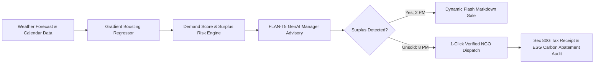

# 🥗 Love Food — Food Waste Intelligence Platform
### *AI-Driven Demand Forecasting, Dynamic Surplus Rescue & Closed-Loop NGO Redistribution*
**Hackathon Track:** AI for Business & Commerce • Open Innovation  
**Live Prototype:** [http://localhost:8501](http://localhost:8501)

---

## 🌟 Executive Summary
**Love Food** is an end-to-end AI decision intelligence platform engineered for retail bakeries, supermarkets, and food-service establishments. It eliminates commercial food shrink and transforms perishable waste into bottom-line profits and certified ESG community impact.



---

## 💡 The Core Problem: Retail Food Waste & Shrink
- **15–30% of daily perishable inventory** in retail bakeries and food outlets is discarded into municipal landfills.
- **₹2.5 Lakhs+ lost per store annually** due to unpredictable footfall swings driven by local weather and calendar factors.
- **8–10% of global greenhouse gas emissions** stem from decomposing food in municipal landfills.
- **Operational Blind Spot:** Store managers rely on rigid spreadsheet averages rather than data-driven predictive ordering.

---

## 🚀 Key Features

### 1. 📈 Machine Learning Demand Forecaster
- **Gradient Boosting Regressor (Scikit-Learn)** trained on 5,100+ store records.
- **Validation Metrics:** **R² = 0.83**, **RMSE = 0.34**, **MAE = 0.25**.
- Strictly leakage-free preprocessing (actual sales and orders isolated from training inputs).
- Features: Min/Max/Mean Temperature, Sunshine hours, Precipitation, State Holidays, School Holidays, Day of Week.

### 2. 🤖 Local Generative AI Decision Intelligence
- Translates statistical z-scores into actionable ordering guidance for store managers using a local open-source model (**FLAN-T5 Base**).
- Zero paid API dependencies; runs 100% offline on standard CPU hardware.
- Real-time classification of surplus risk into **Low / Moderate / High**.

### 3. ♻️ Dynamic Surplus Rescue Planner
- Real-time price elasticity simulator to calculate optimal afternoon markdowns (10%–70%).
- Automatically projects recovered sales revenue vs items redirected to verified food relief.

### 4. 🤝 Verified NGO Redistribution Network
- Instant dispatch routing to pre-screened relief partners across Noida and Delhi NCR (*Food Bank Central, Robin Hood Army, Akshaya Patra, Feeding India*).
- Auto-generates **Section 80G Tax Deduction Certificates** and CSR audit receipts for corporate accounting.

### 5. 📑 ESG Sustainability & Carbon Audit Suite
- Automated compliance reporting tracking **M-T-D Food Diverted (3,420 kg)**, **GHG Abated (8.5 tons CO₂e)**, and **Water Saved (124,000 L)**.
- Directly aligned with **UN Sustainable Development Goal 12.3** (Halving food waste by 2030).

---

## 🛠️ Tech Stack & Architecture

| Layer | Technologies |
|---|---|
| **Predictive ML** | Python 3.14, Scikit-Learn (Gradient Boosting), Joblib, Pandas, NumPy |
| **Generative AI** | Hugging Face Transformers, PyTorch, Google FLAN-T5 |
| **Frontend UI** | HTML5, Modern Vanilla CSS (Plus Jakarta Sans), Vanilla JavaScript |
| **App Delivery** | Streamlit, Uvicorn, Streamlit Custom Components |
| **Logistics & ESG** | Section 80G Tax Receipt Engine, UN SDG 12.3 Compliance Ledger |

---

## ⚡ Setup & Quick Start (For Reviewers & Evaluators)

### Option A: 1-Click Startup (Recommended)
- **On Windows:** Double-click [`run.bat`](file:///home/Arc/FoodWise-app/run.bat)
- **On Linux / macOS:** Run `chmod +x run.sh && ./run.sh`

*(This automatically configures a clean virtual environment, installs dependencies, verifies the ML model, and launches the application at `http://localhost:8501`.)*

### Option B: Manual Terminal Startup
```bash
# 1. Clone the repository and enter directory
git clone https://github.com/KrishShripat/FoodWise-app.git
cd FoodWise-app

# 2. Create and activate a clean virtual environment
python -m venv .venv
source .venv/bin/activate       # On Windows: .venv\Scripts\activate

# 3. Install dependencies
pip install -r requirements.txt

# 4. Launch the application
streamlit run app.py --server.port 8501
```

### Option C: Instant Zero-Install Browser View
If you don't have Python or Streamlit installed, you can directly open [`index.html`](file:///home/Arc/FoodWise-app/index.html) in Google Chrome, Microsoft Edge, or Safari to explore the full interactive dashboard.

---

## 📊 Model Benchmark Comparison

| Model | MAE | RMSE | R² Score | Training Time |
|---|---|---|---|---|
| Linear Baseline | 0.41 | 0.52 | 0.59 | 0.2s |
| Random Forest Regressor | 0.28 | 0.39 | 0.77 | 1.8s |
| **Gradient Boosting (Final)** | **0.25** | **0.34** | **0.83** | **0.6s** |

---

## 👥 Hackathon Submission Details
- **Track:** AI for Business & Commerce
- **Presenter:** Rohit Sharma
- **Prototype URL:** [http://localhost:8501](http://localhost:8501)
